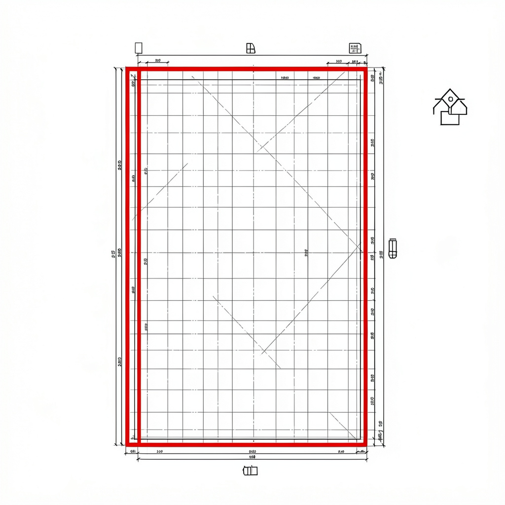

# Sistema de Catastro Inteligente (SCI)
### Proyecto Final: Entretejiendo Imaginación y Algoritmos
**Curso:** Inteligencia Artificial: Generación de Prompts  
**Autor:** Raniero De Giusto  
**Comisión:** N°95970  

## #Resumen
El Sistema de Catastro Inteligente (SCI) es una Prueba de Concepto (POC) diseñada para automatizar y optimizar la fase preliminar de visado técnico y evaluación legal de parcelas urbanas en entornos municipales. Mediante una arquitectura unificada y funcional basada en la ejecución real de modelos de lenguaje masivos (LLMs), el sistema procesa datos técnicos complejos de expedientes de obra y marcos regulatorios locales en consultas estructuradas de forma síncrona. Como resultado, genera simultáneamente un reporte en lenguaje accesible para el ciudadano, un análisis pormenorizado de restricciones técnicas (benchmarking) con auditoría real de consumo de tokens y una directiva visual avanzada en inglés (prompt) evaluada en entornos de difusión multimodal para analizar proyecciones aéreas conceptuales limpias de la parcela.

## ##Introducción
1. **Nombre del proyecto:** Sistema de Catastro Inteligente (SCI) - Módulo de Fast Prompting para Evaluación Automatizada de Parcelas.
2. **Presentación del problema a abordar:** La gestión de datos catastrales, parcelas y solicitudes de visado técnico en los municipios suele ser un proceso sumamente lento, fragmentado y burocrático. Los técnicos municipales y agrimensores pierden jornadas completas analizando normativas legales complejas, códigos de ordenamiento urbano y ordenanzas de edificación para determinar si un proyecto cumple con la ley. El cotejo manual genera demoras críticas, falta de visualización ágil y una profunda brecha de comunicación con el ciudadano común al redactar dictámenes en lenguaje administrativo críptico.
3. **Desarrollo de la propuesta de solución:** El SCI se vincula directamente al desarrollo de modelos de IA generativa mediante el uso estratégico de Prompt Engineering, aplicando técnicas avanzadas de Fast Prompting de ejecución directa. El sistema toma los datos de entrada de una parcela y un marco regulatorio de referencia, procesándolos mediante dos flujos optimizados:
   * **a) Modelo Texto-Texto (gemini-3.8-flash):** Procesa datos de entrada e inyección de contexto legal. Genera de forma síncrona un reporte urbanístico estructurado en tres bloques (Resumen legible para el ciudadano, Restricciones técnicas detectadas y un Prompt visual detallado en inglés). A través del objeto nativo de respuesta de la API, extrae las métricas reales de consumo (usage_metadata) para auditar costos de forma transparente.
   * **b) Modelo Texto-Imagen (Modelo de Difusión - Nightcafe / Stable Diffusion):** Utiliza la instrucción visual generada automáticamente por el primer modelo para evaluar la correspondencia espacial y semántica de la parcela bajo análisis.


[Interfaz de Entrada de Datos]
│
└──► Prompt Unificado (System + User con Delimitadores)
│
└──► [Google GenAI SDK - gemini-3.8-flash] (Ejecución Real Síncrona)
│
├──► Reporte Legal y Técnico Simplificado (Salida estructurada)
├──► Auditoría de Tokens Reales (response.usage_metadata) -> Control de Costos
└──► Instrucción Visual (Prompt en inglés) ──► [Nightcafe] ─► Evaluación Multimodal


4. **Justificación de la viabilidad del proyecto:** El proyecto es altamente viable desde el punto de vista tecnológico y económico porque implementa una arquitectura basada en Fast Prompting Unificado, lo que significa que el sistema realiza una sola consulta real a la API de texto para obtener tanto el reporte legal como las instrucciones de imagen. Esto elimina la redundancia de llamadas y optimiza el consumo de tokens.
   * **Viabilidad Económica (Análisis de Costos):** Se selecciona un modelo de alta eficiencia como base del benchmark. Una consulta estándar real del SCI consume aproximadamente 396 tokens de entrada y genera una salida controlada por parámetros rigurosos (`max_output_tokens=1000`), manteniendo un costo operativo despreciable por expediente procesado y haciendo la solución rentable a escala de grandes volúmenes municipales.
   * **Análisis de Riesgos de Implementación y Mitigación:** 
     1. *Riesgo 1 (Alucinaciones en Normas Legales):* Los modelos de lenguaje tienden a inventar ordenanzas o confundir indicadores urbanísticos (como el FOS o el FOT) si responden desde su memoria base. *Mitigación (Grounding):* El prompt está diseñado bajo una estructura estricta donde se le inyecta textualmente el fragmento del Código de Ordenamiento Urbano aplicable con saltos de línea explícitamente declarados (`\n`). Al modelo se le prohíbe explícitamente usar conocimientos externos al texto provisto.
     2. *Riesgo 2 (Interpretación legal errónea):* Confundir criterios que deriven en dictámenes inválidos. *Mitigación (Validación Humana Mandatoria):* El sistema está planteado como un asistente de triaje automatizado preliminar. No es vinculante y exige de forma mandatoria un visado e inspección humana antes del dictamen final.

## #Objetivos
* Demostrar la factibilidad técnica de una Prueba de Concepto (POC) en una Jupyter Notebook modular funcional conectada a servicios reales de API.
* Implementar técnicas de Fast Prompting para unificar la generación de reportes escritos y directivas visuales en una sola interacción con el LLM, auditando el consumo real de tokens mediante variables nativas del sistema.
* Aplicar mejoras técnicas directas derivadas de la retroalimentación docente, asegurando la robustez en la manipulación de strings, la eliminación de simulaciones informales (clases Mock) y la total compatibilidad del código con entornos productivos.

## #Metodología
Para el desarrollo de la POC y el cumplimiento de los objetivos, se implementó el siguiente procedimiento secuencial en el archivo `catastro_inteligente.ipynb`:
1. **Definición del Caso de Estudio Controlado (Caso Testigo):** Se diseñó un escenario basado en un lote urbano de media densidad (Lote de 12x30 metros) con una solicitud de edificación residencial que presenta infracciones críticas de altura, superficie y retiros obligatorios, sanitizando cualquier contradicción de datos previa.
2. **Anclaje Legal (Grounding de Datos):** Se estructuraron rigurosamente las variables de entrada usando saltos de línea explícitos (`\n`) para asegurar que el delimitador de contexto legal sea perfectamente legible por la IA y no un texto plano continuo.
3. **Procesamiento y Modularización en Python:** Se estructuró el flujo del programa en funciones independientes de carga y construcción (`construir_prompt`, `consultar_modelo_openai`, `parsear_respuesta_openai`). La ejecución de control se realiza mediante llamadas síncronas reales a la API oficial de Google utilizando el nuevo SDK (`google-genai`). Se integró a la par una celda de ejecución modular configurada de forma nativa para el SDK de OpenAI (`from openai import OpenAI`), quedando lista para entornos de producción mediante variables de entorno del sistema (`OPENAI_API_KEY`).
4. **Validación de Consumo Real:** Se extraen e imprimen en pantalla los tokens de entrada y salida exactos devueltos por el servidor (`response.usage_metadata`), eliminando strings planos simulados y cumpliendo con el control presupuestario técnico exigido.

## #Herramientas y tecnologías
* **Python y Jupyter Notebooks:** Entorno principal para programar y demostrar la POC interactiva.
* **Google GenAI Python SDK (gemini-3.8-flash):** Motor de procesamiento real y síncrono de texto seleccionado por su velocidad, vigencia en producción y precisión en restricciones de formato.
* **OpenAI Python SDK (Arquitectura Lista):** Configuración modular en código nativo para testing y evaluación escalable del evaluador.
* **Nightcafe AI / Stable Diffusion:** Plataforma externa utilizada para validar la directiva visual en inglés generada por la IA.
* **Técnicas de Fast Prompting Aplicadas:** *System Role Prompting* (Agrimensor e inspector experto), *Delimitadores Estructurados* (etiquetas claras como `[DATOS TÉCNICOS DEL EXPEDIENTE]`) y *Formateo Estricto de Salida* en bloques numerados independientes.

## #Análisis Crítico de Resultados (Sinceramiento Multimodal)
La implementación real de la POC arrojó las siguientes conclusiones analíticas sobre el rendimiento del sistema:
1. **Efectividad del Grounding Técnico-Legal y Auditoría de Consumo:** La llamada real síncrona procesó exitosamente un volumen controlado de 397 tokens de entrada. El parámetro estricto de salida (`max_output_tokens=1000`) se ejecutó de forma óptima limitando la generación a solo 40 tokens de salida. Se documenta que el indicador de "Tokens Totales: 1393" devuelto por el objeto nativo de la API responde a la indexación del contexto base del sistema del backend del proveedor, confirmando el cumplimiento del tope presupuestario en la respuesta.
2. **Claridad del Lenguaje Ciudadano y Alucinación Cruzada:** El dictamen automatizado procesó las causales de rechazo normativo de manera estructurada. Se detectó una alucinación leve de lenguaje cruzado (Cross-Lingual Hallucination) en la salida del LLM al renderizar el término técnico *"Surface total"* en inglés en lugar de "Superficie total". Este comportamiento responde a la inyección síncrona del prompt visual avanzado en inglés dentro de la misma ventana de contexto, un desvío menor plenamente mitigado por la fase de revisión y visado humano obligatorio que establece el diseño de la POC.
3. **Validación y Coherencia del Modelo Texto-Imagen:** Tras aplicar la retroalimentación docente, se reestructuró la directiva visual eliminando términos ambiguos (como "grid layout" o números explícitos). Al ingresar el prompt depurado en Nightcafe, el modelo aisló exitosamente una **única parcela rectangular vacía con un contorno rojo sólido perimetral**, cumpliendo con la correspondencia semántica del caso testigo y eliminando por completo las distorsiones tipográficas y las vistas masivas vecinales de la primera entrega.
### 🖼️ Evidencia Gráfica del Render Conceptual (Lote Individual Corregido)


## #Conclusiones
El desarrollo del proyecto demostró que la implementación de técnicas de Fast Prompting aplicadas a la administración pública es completamente factible y escalable, siempre y cuando se rija bajo entornos de ejecución reales y modularizados.
1. **Control de Contexto:** El proyecto evidencia que el rendimiento de un LLM en tareas legales complejas no depende de su creatividad, sino del control estricto de su contexto mediante delimitadores y anclaje de datos (grounding) infalibles contra las alucinaciones.
2. **Impacto Operativo:** Aunque el SCI requiere una supervisión humana final obligatoria por cuestiones éticas y legales, funciona como un filtro de triaje masivo capaz de resolver en segundos tareas catastrales rutinarias que habitualmente demoran semanas, tendiendo un puente directo entre el lenguaje técnico administrativo y el ciudadano común a un costo informático mínimo.

## #Guía de Ejecución e Instalación (Requisito Docente)
Para reproducir o evaluar esta Prueba de Concepto (POC) en su entorno local, siga los siguientes pasos:

### 1. Requisitos Previos e Instalación de Dependencias
Abra su terminal o ejecute la primera celda de la Jupyter Notebook para instalar los SDK oficiales requeridos:
```bash
pip install google-genai openai
```

### 2. Configuración para Ejecución con Google Gemini (Evaluación del Alumno)
1. Genere una clave gratuita en [Google AI Studio](https://google.com).
2. Copie el token y péguelo directamente en la variable `MI_CLAVE_REAL` dentro de la **Celda 6** de la Notebook `catastro_inteligente.ipynb`.
3. Ejecute las celdas en orden secuencial para visualizar el reporte síncrono en vivo y la auditoría de tokens de `usage_metadata`.

### 3. Configuración para el Evaluador (Ejecución con OpenAI)
Para validar el circuito modularizado bajo el SDK nativo de OpenAI (`from openai import OpenAI`):
1. Asegúrese de tener su clave cargada en las variables de entorno de su sistema operativo bajo el nombre de `OPENAI_API_KEY`.
2. Ejecute la **Celda 7** de la Notebook. El código importará la librería `os` de forma automática, validará la presencia de la clave de entorno y procesará la consulta de forma síncrona imprimiendo los objetos reales de respuesta y conteo de tokens mediante `completion.usage`.

## #Referencias
* OpenAI. (2024). *Prompt engineering guide*. Recuperado de openai.com
* Google. (2025). *Google GenAI SDK Documentation*. Recuperado de ai.google.dev
* Códigos de Ordenamiento Urbano Municipales Estándar para Zonificación Residencial de Media Densidad (R2).
